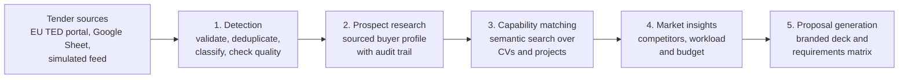
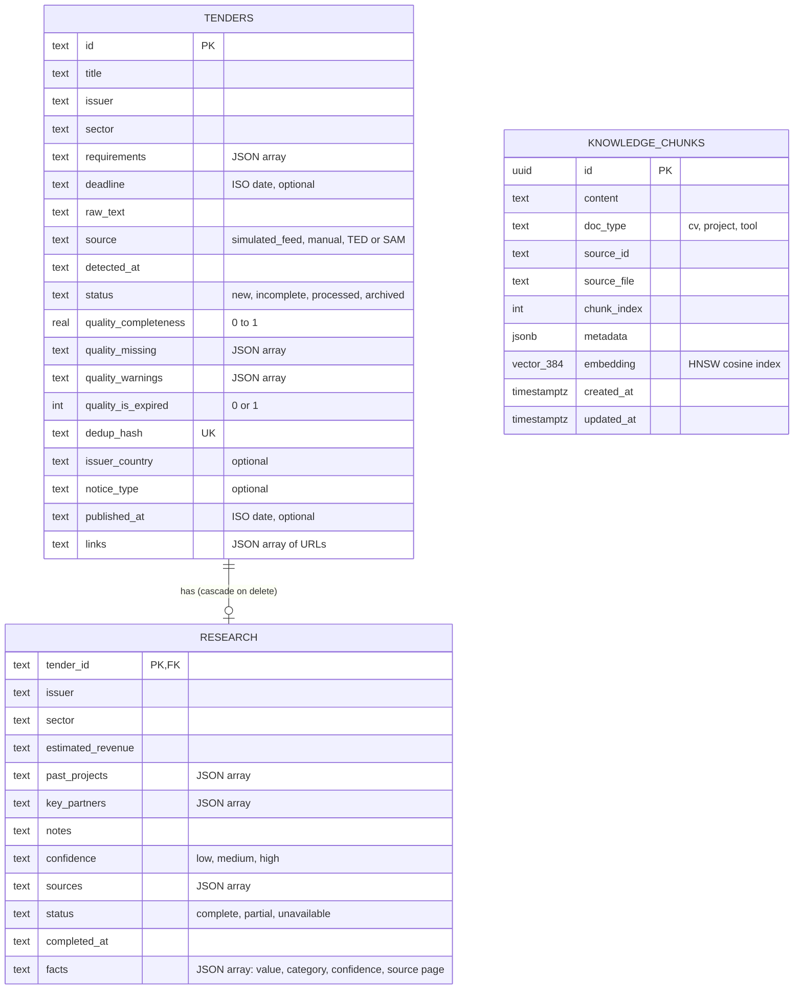
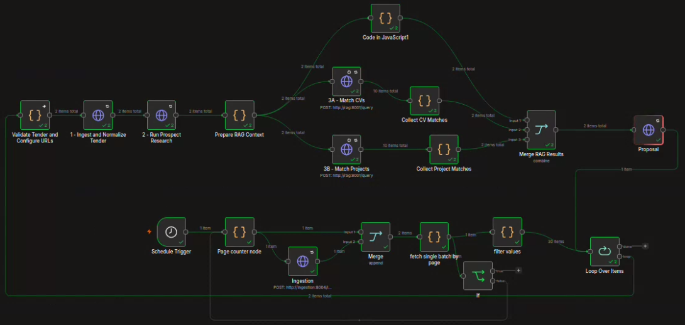

# OliveSoft RFP Intelligence Platform

**From a published tender to a branded, evidence-backed proposal deck: tender detection, buyer research, capability matching and proposal generation in one pipeline.**

**Built with:** Python 3.11 · FastAPI · n8n · SQLite · Supabase pgvector · sentence-transformers · python-pptx · Docker Compose

---

## Table of Contents

1. [What is it](#1-what-is-it)
2. [What we built](#2-what-we-built)
3. [The product experience](#3-the-product-experience)
4. [Agents, judge and trust layer](#4-agents-judge-and-trust-layer)
5. [Why OliveSoft stands out](#5-why-olivesoft-stands-out)
6. [How to run it](#6-how-to-run-it)
   - [API reference](#api-reference)
   - [Configuration](#configuration)

---

## 1. What is it

Answering a request for proposal (RFP) takes three slow, manual jobs: understanding what the buyer is asking for, understanding who the buyer is, and proving that OliveSoft has the people and track record to deliver.

This platform does all three and writes the first draft. A tender comes in, and out comes a branded proposal deck backed by a sourced profile of the buyer, a ranked shortlist of OliveSoft's matching CVs and past projects, and a requirements matrix that scores every requirement against that evidence. When the evidence is too weak, it recommends not bidding.

### The problem

| Pain point | Consequence |
|---|---|
| Tenders arrive as unstructured text of varying quality | Analysts spend hours extracting requirements and judging fit |
| Buyer research is manual and inconsistent | Bid decisions rest on incomplete or unsourced information |
| Internal expertise is scattered across CVs and project records | The strongest evidence of capability is often not found in time |
| Proposals are written and formatted by hand for every bid | Every response is slow to produce and inconsistent in quality |
| Generic AI tools give no provenance | Stakeholders cannot verify, and therefore cannot trust, machine-generated claims |
| Agents that read the open web are an attack surface | A single malicious page can manipulate the output or leak data |

---

## 2. What we built



n8n runs the pipeline on a schedule. Every stage is independently callable, testable and replayable, so a failed step does not require restarting the whole bid. Proposal generation can also be replayed from the command line without any service running.

| Part | What it does | Key design choice |
|---|---|---|
| **Ingestion** (port 8004) | Pulls IT and software services tenders from TED (EU) and SAM.gov (US), maps both into one canonical notice schema, and feeds detection page by page through n8n | Chain-of-Responsibility source adapters, pagination caps, source-aligned API keys/limits, egress-guarded HTTP and normalized downstream contracts |
| **Detection** (8000) | Validates, de-duplicates, extracts requirements and classifies each tender against OliveSoft's five service lines (Data Integration, AI Development, BI and Dashboarding, Salesforce Ecosystem, Data Platform). Scores data quality: missing fields, warnings, expired deadline | Keyword rules first, LLM only as a fallback. An unchanged re-submission returns the stored record at zero LLM cost |
| **Prospect research** (8002) | Fills four facts about the buyer (sector, estimated revenue, past projects, key partners) from web search, with sources and a confidence level. Skips expired tenders and caches results per tender | Plain code runs the search loop. The only LLM that reads web text is quarantined: no tools, strict JSON out, and any deviation yields zero facts. Confidence is computed from distinct sources, never reported by the model |
| **Capability matching (RAG)** (8001) | Finds the CVs, past projects and tools that best match a tender | Local 384-dimension embeddings and a pgvector HNSW index. OliveSoft's own projects get a boost applied after retrieval and capped at 0.10, so an unrelated internal project can't outrank a strong match |
| **Competitor & Budget Insights** (8006) | Builds a decision sheet from the tender, explicit budget signals, public comparables, OliveSoft project history and a validated workload proposal | A bounded tool-using analyst chooses actions; code owns arithmetic, URLs, confidence, evidence validation and the final budget. The run is stored with a human-readable trace |
| **Proposal generator** (8003) | Turns a tender, its research and its matches into a 9-slide branded deck (.pptx and PDF) with a requirements matrix (.csv) that rates each requirement Strong, Partial or Gap. Runs as a Docker service (`POST /proposal/{tender_id}`) and replayable from the command line | Code writes every fact: scores, names, years, prices. The model writes prose only, one section at a time, and every reply is checked before it reaches a slide. When no requirement reaches 0.40, it writes a no-bid deck without calling the model |
| **UI** (8005) | Serves the web app in `ui-preview/` and proxies its `/api/*` calls to the services above. See [The `ui` service](#the-ui-service) | The browser never holds the internal token: the proxy adds it on every upstream call |
| **n8n workflows** (`n8n/workflows/`) | **Phase 1 RFP Orchestrator:** every 20 s, reads tenders from a Google Sheet, loops them through detection, research and matching (CVs and projects in parallel), computes an overall coverage score from the raw similarity scores, and appends the summary to a results sheet. **Phase 2 RFP Orchestration:** every 20 s, walks the ingestion service page by page until the page cap, then for every notice runs detection, research, matching and an end-to-end proposal call that builds the deck | Ship inactive. Every service call carries the internal token; the proposal call retries up to 3 times with a 120 s timeout |

### Data model



`TENDERS` and `RESEARCH` live in SQLite (WAL mode, foreign keys on). `KNOWLEDGE_CHUNKS` lives in Supabase and is unique on `(source_id, chunk_index)`.

### Security

| Threat | Control | Evidence |
|---|---|---|
| Prompt injection via web content | Trusted instructions on the system channel, untrusted text in the user message; strict output schema; fail-closed (zero facts) on any deviation; snippet and fact size caps | `research/tests/test_injection_resistance.py` |
| Inflated confidence via hijacked output | Confidence computed from distinct sources; a repeated fact does not count as a new source | End-to-end compromised-extractor test |
| Invented facts in proposals | Code writes every score, name, year and price; each writing step may cite only the records in its own inputs; a validator blocks any deck with issues | The citation check rejected 3 of 158 replies that cited an outside record |
| Audit log forgery | Untrusted text escaped to a single line before hashing; per-entry SHA-256; per-run correlation ID | Log-forgery tests |
| Credential leakage in logs | Secret scrubber on the research extractor's logger and on every service's error logs (the shared error handler and uvicorn's error log), covering messages and tracebacks, SAM.gov API key included; sensitive parameter names redacted in the audit log | Redaction tests |
| Server-side request forgery | http/https only; private, loopback, link-local and reserved addresses blocked by an egress policy; redirects never followed; research web fetches capped at 256 KiB, TED API responses at 4 MiB and SAM.gov API responses at 64 MiB | `research/tools/fetch.py` |
| Token guessing by timing | Constant-time comparison; an unset token fails closed | Auth tests |
| Malformed or oversized input | Strict Pydantic models, `extra="forbid"` on request bodies, bounds on every field; one error format across services | Schema and normalization tests |
| Direct database access | Row-level security on; search function is `security invoker` with a pinned `search_path`; privileges revoked from `public`, `anon`, `authenticated` | `sql/schema.sql` |
| Vulnerable or leaked dependencies | CI runs gitleaks, Bandit, Semgrep and pip-audit; GitHub Actions pinned to commit SHAs; weekly scheduled scan | `.github/workflows/security.yml` |
| Container compromise | Non-root runtime user; pinned base image; locked dependencies | `Dockerfile`, `requirements.lock` |

---

## 3. The product experience

The UI is not a mock dashboard. It is a secure client over the live services: every screen reads real records, every action calls the corresponding backend, and failures use the shared error envelope.

### The demo journey

1. **Overview** — Pipeline health, active tenders, deadlines, alerts and current bid workload.
2. **Tenders** — Load TED, SAM.gov or the simulated feed; filter by source, status, country and deadline; inspect normalized notices and documents.
3. **Research** — Inspect sourced buyer facts, confidence, the research trace and the tamper-evident audit history.
4. **Match** — Find the best people, projects and tools for each requirement with similarity, ranking and evidence metadata.
5. **Insights** — Review explicit budget signals, comparable contracts, competitors, workload, a TND budget envelope and proposed positioning.
6. **Draft / Review / Export** — Generate a branded proposal, inspect Strong / Partial / Gap evidence, review warnings, sign off sections, and download PPTX, PDF and CSV.
7. **Library and Settings** — Inspect indexed knowledge, check service health, configure sources, theme and proposal safeguards.

The app surfaces uncertainty as alerts: degraded research, unsupported claims, duplicate notices, hidden characters, refused/no-bid decks and missing evidence never disappear behind fluent prose.

### UI architecture

```text
Browser (ui-preview/src) -> /api/* -> FastAPI proxy (ui-preview/server)
                                      |-- ingestion 8004
                                      |-- detection 8000
                                      |-- research 8002
                                      |-- insights 8006
                                      |-- rag 8001
                                      `-- proposal 8003
                                      
                                      
```

The browser never receives the internal service token. The proxy adds it server-side, enforces upstream timeouts, forwards supported routes, maps failures consistently and serves the static app from the same origin. See [`ui-preview/README.md`](ui-preview/README.md).

---

## 4. Agents, judge and trust layer

OliveSoft is deliberately **not one unconstrained chatbot**. It is a set of bounded agents surrounded by deterministic code.

### The agent team

- **Detection agent:** normalizes notices, validates fields, deduplicates, extracts requirements, tags service lines and records data-quality warnings. Rules handle predictable cases first; LLM fallback is bounded and replaying a notice is idempotent.
- **Prospect researcher:** code owns search and fetching; a quarantined extractor sees labelled web text and can return only strict JSON facts. It cannot call tools, invent URLs or set confidence. Runs are cached, auditable and skipped for expired tenders.
- **Capability matcher:** hybrid lexical/semantic RAG searches CVs, projects and tools while preserving source identifiers and metadata for review.
- **Competitor & Budget Insights:** a bounded tool-using analyst examines the tender, explicit budgets, verified comparables, past projects and workload. The model never writes prices, URLs or confidence; code owns arithmetic, evidence and final ranges.
- **Proposal writer:** receives narrow section inputs and writes prose only. Code owns scores, labels, names, roles, years, prices, warnings, the no-bid gate and every matrix row. Replies are schema-, length- and citation-checked before entering a slide.

### The independent grounding judge

The optional verifier is a separate model from the writer. It checks each accepted prose claim against exactly the sources available to that writing step and classifies it as `supported`, `partial` or `unsupported`. Code then re-finds each supported quote; missing quotes are downgraded, while partial and unsupported claims become bid warnings.

```bash
export PROPOSAL_VERIFIER_LLM_MODEL=gemma2:9b-instruct
```

The judge is opt-in until measured recall justifies default-on operation. Proposal metadata shows whether it ran, separating **what the writer said**, **what the sources support**, and **what a human must decide**.

### Evidence contract

```text
tender -> requirement -> retrieval hit / web source -> agent step -> checked claim -> slide / warning
```

No evidence means no confident claim. Weak evidence becomes Partial, Gap, low confidence, an explicit assumption or a no-bid recommendation.

---

## 5. Why Our RFP & Proposal Automation stands out

- **Evidence before eloquence:** every important claim traces to a tender, source page, CV, project or tool record.
- **Honest no-bid decisions:** weak fit produces an explainable no-bid deck without spending proposal-model budget.
- **Decision-grade economics:** explicit budgets, verified comparables, past-project evidence and bounded workload modeling replace guesswork.
- **Human control:** ingestion, research, generation, forced bids, section approval and sign-off are explicit actions.
- **Composable ingestion:** TED and SAM.gov use source-specific adapters behind one canonical schema; adding a source does not change detection, matching or proposal services.
- **Operationally demoable:** the same journey works in the UI, n8n, curl, MCP or offline recorded runs.
- **Fail-closed trust:** malformed output, unsupported citations, suspicious web content and invalid artifacts produce warnings or no result.
- **Built for extension:** new sources implement the same contract; services have stable schemas and health endpoints.

### Standout techniques

| Technique | Why it matters |
|---|---|
| **Canonical ingestion contract** | TED, SAM.gov, manual and simulated notices become one validated schema, so new sources do not ripple through the pipeline. |
| **Hybrid retrieval with reranking** | Lexical precision and semantic similarity are combined, then internal-project boosts are capped so relevance wins over familiarity. |
| **Deterministic facts, bounded prose** | Code owns scores, prices, identities, thresholds and labels; models only write scoped prose. |
| **Fail-closed agent loops** | Strict schemas, tool allow-lists, turn/time/retry limits and no-number/no-URL rules prevent plausible fabrication. |
| **Independent grounding judge** | A different model checks accepted claims against their exact evidence and converts uncertainty into visible warnings. |
| **Evidence graph and audit trail** | Tender → requirement → source → agent step → claim → slide remains inspectable and reviewable. |
| **Replayable workflows** | Recorded runs, traces, health endpoints, idempotency and shared error envelopes make demos and operations reproducible. |

### A compelling 90-second pitch

> Give OliveSoft a tender. In minutes it tells us whether to bid, why, with whom, against whom, and at what evidence-backed effort. It ingests the notice, researches the buyer, finds the right team, checks the market, builds the deck and exposes every uncertainty. The system does not ask us to trust AI — it shows us the trail.

### What judges can verify live

| Moment | Proof point |
|---|---|
| Load a tender | Normalization, deduplication and data-quality warnings |
| Open Research | Sourced facts, computed confidence and audit trace |
| Open Match | Ranked CV/project evidence rather than generic recommendations |
| Run Insights | Tool trace, competitor URLs, workload assumptions and budget method |
| Generate Deck | Strong / Partial / Gap matrix, warnings and downloadable artifacts |
| Enable the judge | Independent claim verdicts without rewriting the deck |
| Ask via MCP | Read-only natural-language access to the same live records |

---

## 6. How to run it

### Quick look: no API keys, no Docker

```bash
pip install -r proposal/requirements.txt
python -m proposal.demo
```

This replays recorded model runs for three tenders and writes each deck (.pptx), its requirements matrix (.csv) and, if LibreOffice is installed, a PDF to `out/`. Add `--live` to call the model instead (needs `LLM_API_KEY` and `LLM_URL`).

### Full stack

**Prerequisites:** Docker with Compose, a Supabase project, an LLM API key and a Tavily API key.

**1. Configure the environment**

```bash
cp .env.example .env
# Set: INTERNAL_SERVICE_TOKEN, LLM_API_KEY, LLM_MODEL, TAVILY_API_KEY,
#      SUPABASE_URL, SUPABASE_SERVICE_KEY
```

Set `LLM_MODEL` to a current model: the value shipped in `.env.example` has been retired by its provider.

**2. Create the vector schema.** Run `sql/schema.sql` in the Supabase SQL editor.

**3. Start the services**

```bash
docker compose up --build
```

Detection runs on 8000, RAG on 8001, research on 8002, proposal on 8003, ingestion on 8004, the UI on 8005 and n8n on 5678.

**4. Load the knowledge base**

```bash
docker compose --profile tools run --rm rag-ingest
```

**5. Try it**

```bash
export TOKEN="$INTERNAL_SERVICE_TOKEN"

# Load the simulated tender feed
curl -X POST localhost:8000/tenders/seed -H "X-Internal-Token: $TOKEN"

# Pull live tenders from the EU TED portal (page 1)
curl -X POST localhost:8004/ingest/TED \
  -H "X-Internal-Token: $TOKEN" -H "Content-Type: application/json" \
  -d '{"page": 1}'

# Research the buyer of one tender
curl -X POST localhost:8002/research/tender-001 -H "X-Internal-Token: $TOKEN"

# Find the best-matching CVs
curl -X POST localhost:8001/query \
  -H "X-Internal-Token: $TOKEN" -H "Content-Type: application/json" \
  -d '{"text":"MuleSoft integration with master data management","top_k":5,"doc_type":"cv"}'

# Build the proposal deck for one tender
curl -X POST localhost:8003/proposal/tender-001 \
  -H "X-Internal-Token: $TOKEN" -H "Content-Type: application/json" \
  -d '{}'
```

The proposal call writes the deck, matrix CSV and (if LibreOffice is present) PDF to `proposals/`, and returns their paths. `GET /proposal/{tender_id}` returns the stored result.

**6. Run the workflows.** Open n8n at `http://localhost:5678` and import the workflows from `n8n/workflows/` (mounted in the container at `/files/workflows`):

- `Phase 1 RFP Orchestrator` — reads tenders from a Google Sheet and appends a coverage summary (tender title, overall score, CV and project matches) to a results sheet.
- `Phase 2 RFP Orchestration` — pulls tenders through the ingestion service one page at a time, then runs detection, research, matching and the proposal generator for each one, end to end.

The Phase 2 workflow, as it appears in n8n:



Connect your Google service account for Phase 1, then make sure the HTTP nodes send your `INTERNAL_SERVICE_TOKEN`: they ship with `super-token`. Both workflows ship inactive.

### The `ui` service

The `ui` service (port 8005, `ui-preview/server/`) is a small FastAPI proxy. It serves the web app from `ui-preview/` at `/` and forwards the app's `/api/*` calls to detection, RAG, research, proposal and ingestion. It adds the internal token on the server side and maps every upstream failure to the shared error envelope, so the browser never sees the token. The app has no mock mode: every screen reads and acts on the live services.

In Compose it starts with the rest of the stack and binds to `127.0.0.1:8005` only:

```bash
docker compose up --build
# open http://127.0.0.1:8005
```

Outside Docker, run the services you need on their default ports with the same `INTERNAL_SERVICE_TOKEN`, then:

```bash
python -m uvicorn server.app:app --app-dir ui-preview --host 127.0.0.1 --port 8005
```

| Variable | Purpose | Default |
|---|---|---|
| `INTERNAL_SERVICE_TOKEN` | Token the proxy sends upstream as `X-Internal-Token` | Empty (upstream calls then fail with 401) |
| `UIP_DETECTION_URL` | Detection base URL | `http://localhost:8000` |
| `UIP_RAG_URL` | RAG base URL | `http://localhost:8001` |
| `UIP_RESEARCH_URL` | Research base URL | `http://localhost:8002` |
| `UIP_PROPOSAL_URL` | Proposal base URL | `http://localhost:8003` |
| `UIP_INGESTION_URL` | Ingestion base URL | `http://localhost:8004` |
| `UIP_N8N_URL` | n8n base URL, used for the health check only | `http://localhost:5678` |

Compose sets the `UIP_*` URLs to the service names on the Compose network. Upstream timeouts are fixed in the code: 30 s by default, 60 s for ingestion and seeding, 150 s for research and 180 s for deck generation. See [ui-preview/README.md](ui-preview/README.md) for the app itself.

### Run the tests and the benchmark

```bash
pip install -r requirements.txt -r proposal/requirements.txt
export INTERNAL_SERVICE_TOKEN=test-token
pytest detection research shared rag proposal
python -m pytest ui-preview/server/tests       # the ui proxy
node --test "ui-preview/tests/*.test.js"       # the browser API client
python -m rag.evaluate_local     # retrieval benchmark, no database needed
```

### API reference

Every service exposes `GET /health` without authentication. Every other endpoint requires the `X-Internal-Token` header. Errors share one format: `{"error": {"code", "message", "field", "retryable", "request_id"}}`.

| Service | Method and path | Description |
|---|---|---|
| Ingestion | `POST /ingest/TED` | Fetch one page of tenders from TED and map them to tender records. Body: `{"page": 1}`; 422 if `page` is missing or below 1 |
| Ingestion | `POST /ingest/SAM` | Same, for SAM.gov. Needs a SAM key as the second entry of `INGEST_API_KEYS`; 500 if it is missing |
| Detection | `POST /tenders/ingest` | Validate, deduplicate, classify, quality-check and store a tender. Returns 422 on invalid input |
| Detection | `GET /tenders` | List tenders; optional `status` filter (`new`, `incomplete`, `processed`, `archived`) |
| Detection | `GET /tenders/{id}` | Fetch one tender; 404 if absent |
| Detection | `PATCH /tenders/{tender_id}/status` | Archive a tender or restore it. Body: `{"status": "archived"}` or `{"status": "active"}`; `active` restores `new` or `incomplete` from the stored data quality. 404 if absent |
| Detection | `POST /tenders/seed` | Load the bundled simulated feed; a malformed file is reported, not fatal |
| Research | `POST /research/{tender_id}` | Run, or serve cached, prospect research. Expired tenders are skipped |
| Research | `GET /research` | List all stored research |
| Research | `GET /research/{tender_id}` | Fetch stored research; 404 if absent |
| Research | `GET /research/{tender_id}/audit` | The audit-log entries of the latest research run for that tender: `{"run_id", "entries"}` (empty when there is no run) |
| RAG | `POST /query` | Semantic search (request schema below) |
| RAG | `GET /stats` | Record counts per `doc_type` (`cv`, `project`, `tool`): one per record, not per chunk. 503 if the database is unreachable |
| Proposal | `POST /proposal/{tender_id}` | Build the deck, matrix CSV and PDF for one tender. Body fields, all optional: `cv_matches` and `project_matches` (the team matches), `settings`, `force_bid` and `claim_check` (see below). The service always runs the per-requirement matching against RAG itself, but never the team matches: with an empty body the Team and References slides are placeholders and the deck carries two bid warnings. n8n and the `ui` service build the team matches and send them. Returns artifact paths, `checks` (which checks ran) and `trace` (the writing steps) |
| Proposal | `GET /proposal/{tender_id}` | Fetch a stored proposal result; 404 if absent |
| Proposal | `GET /proposal/{tender_id}/files/{name}` | Download one file named in the stored result (.pptx, .pdf or .csv) as an attachment; 404 for any other name |
| Proposal | `GET /proposal/{tender_id}/review` | Reviewer state for the stored deck: per-section status and the sign-off. Empty until saved; 404 if no deck |
| Proposal | `PUT /proposal/{tender_id}/review` | Save section statuses (`draft`, `review`, `approved`, `work`) and a typed sign-off name. 409 if `deck_generated_at` is not the stored deck's, which happens after a regenerate |
| Insights | `POST /insights/{tender_id}` | Run, or serve the run in flight, the Competitor & Budget Insights agent for a tender. Needs the tender live in the detection store. Returns the stored insights sheet, its `trace` (one turn per step) and `stop_reason`; the budget envelope is TND and a `method: "none"` estimate carries no amounts |
| Insights | `GET /insights/{tender_id}` | The latest stored run for a tender: `{"run_id", "created_at", "status", "confidence", "stop_reason", "insights", "trace"}`; 404 if the agent has not run for it |
| UI | `GET /api/*` | Reads, forwarded with the token: `/tenders`, `/tenders/{id}`, `/research`, `/research/{id}`, `/research/{id}/audit`, `/insights` (one stored run per tender, tenders without a run skipped), `/insights/{id}`, `/proposals` (every stored deck), `/proposal/{id}`, `/proposal/{id}/review`, `/library/stats`, `/files/{id}/{name}` (deck downloads) and `/health` (all services) |
| UI | `POST /api/*` | Actions: `/tenders/ingest`, `/tenders/seed`, `/ingest/{TED or SAM}`, `/notices/send` (several notices to detection, one result each), `/research/{id}`, `/insights/{id}` (run the market check, 160 s timeout), `/proposal/{id}` (builds the team matches, then calls proposal; accepts `settings`, `force_bid`, `claim_check`) and `/query` |
| UI | `PATCH /api/tenders/{id}/status`, `PUT /api/proposal/{id}/review` | Archive or restore a tender; save a deck's review |
| All | `GET /health` | Liveness probe, unauthenticated |

Request fields added to `POST /proposal/{tender_id}`:

| Field | Type | Effect | Default |
|---|---|---|---|
| `settings` | object | Overrides the deck values for this run. Every key is optional and unknown keys are refused: `signatory_name`, `signatory_role`, `signatory_contact`, `letter_title`, `currency`, `day_rate` (above 0), `team_size` (1 or more), `investment_note` | none (built-in defaults) |
| `force_bid` | boolean | Build a full deck for a tender that retrieval would answer with a no-bid. Spends model budget | `false` |
| `claim_check` | boolean | Also check every written sentence for claims its sources do not contain | `false` |

Research is a `POST` by design: a run spends search and LLM budget, so crawlers, prefetchers and browser retries must never trigger it.

**RAG query request**

| Field | Type | Constraint | Default |
|---|---|---|---|
| `text` | string | 3 to 10,000 characters | required |
| `top_k` | integer | 1 to 20 | 5 |
| `doc_type` | string | `cv`, `project` or `tool` | none (all types) |
| `similarity_threshold` | number | 0.0 to 1.0 | 0.0 |

**RAG query response item:** `id`, `content`, `doc_type`, `source_file`, `metadata`, `similarity`, `ranking_score`.

**Proposal generator (command line)**

| Command | What it does |
|---|---|
| `python -m proposal.demo [tender-id] [--live \| --replay] [--out DIR]` | Replay or live run for the recorded tenders (`tender-001`, `heldout-001`, `tender-014`); writes .pptx, .matrix.csv and PDF |
| `python -m proposal <deck.json> <out.pptx>` | Render and validate a deck JSON; exits 1 and writes nothing if the validator objects |

### Configuration

| Variable | Purpose | Default or example |
|---|---|---|
| `INTERNAL_SERVICE_TOKEN` | Shared secret for service authentication | Required |
| `LLM_PROVIDER` | `anthropic`, `openai` or `ollama` (any OpenAI-compatible endpoint) | `anthropic` |
| `LLM_MODEL` | Model identifier | Required, e.g. `claude-haiku-4-5` |
| `LLM_API_KEY` | Provider credential | Required |
| `LLM_URL` | Endpoint for OpenAI-compatible providers and the proposal generator | Optional |
| `TAVILY_API_KEY` | Web search credential | Required for research |
| `MAX_SEARCH_ITERATIONS` | Research loop cap | 6 |
| `TOTAL_RUN_TIMEOUT_SECONDS` | Research run budget, kept under n8n's 45 s timeout | 35 |
| `PER_CALL_TIMEOUT_SECONDS` | Timeout per search, fetch or LLM call | 8 |
| `RESEARCH_CACHE_TTL_SECONDS` | How long cached research is reused; 0 disables expiry | 3600 |
| `SUPABASE_URL` | Vector database URL | Required for RAG |
| `SUPABASE_SERVICE_KEY` | Server-side database key | Required for RAG |
| `EMBEDDING_MODEL` | Sentence-transformers model | `sentence-transformers/all-MiniLM-L6-v2`; set it explicitly outside Docker |
| `OLIVESOFT_DB_PATH` | SQLite file location | Container: `/data/olivesoft.db` |
| `RESEARCH_AUDIT_LOG` | Audit log path | Container: `/data/research.log` |
| `FETCH_MAX_BYTES` | Body cap for research web fetches only (TED and SAM.gov have their own caps in ingestion) | 262144 |
| `SOFFICE_PATH` | LibreOffice binary for PDF export, if not on `PATH` | Optional |
